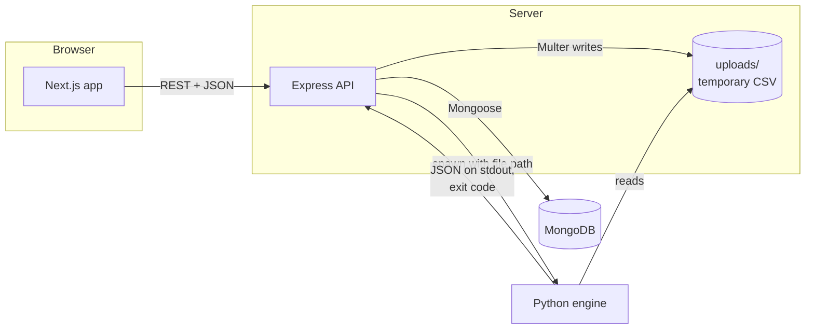
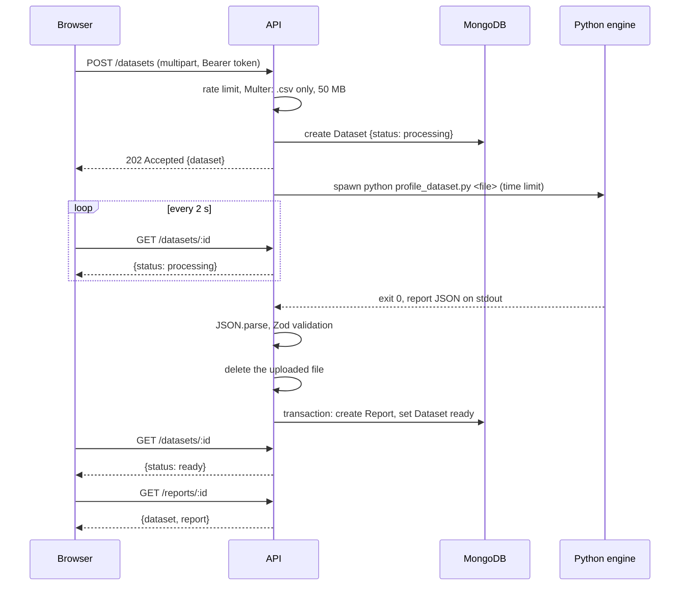
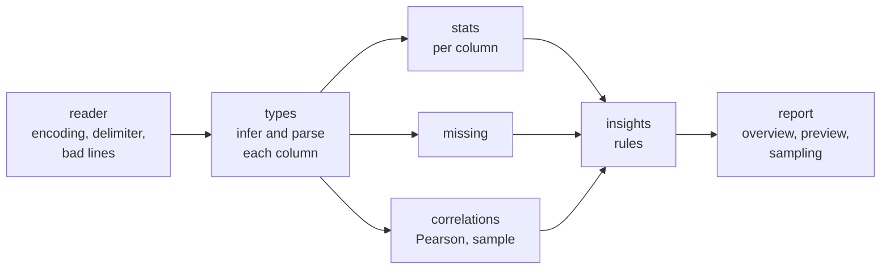
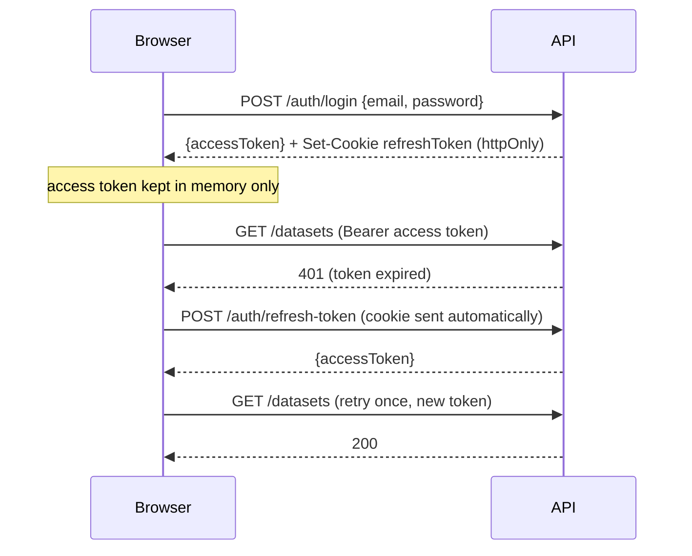

# Architecture

How InsightLens is put together and why. The report format itself is in
[report_schema.md](report_schema.md).

## Overview

Each part has one job:

| Part | Owns | Never does |
|---|---|---|
| Analysis engine (`analysis-engine/`) | Reading the CSV and every statistic in the report | Network or database access |
| API (`backend/`) | Accounts, ownership, files, running the engine, validating and storing reports | Computing statistics |
| Frontend (`frontend/`) | Showing reports, forms, navigation | Computing statistics; it only formats numbers it receives |

This split keeps the analysis testable on its own: the engine is a command
line program with a documented output, so pytest can check it without a
server, and the API's tests can check the contract without knowing how the
statistics are computed.

## Upload and analysis

Decisions in this flow:

- **202, then polling.** A 500,000-row file takes over ten seconds to
  analyze. Answering at once and letting the browser check back keeps the
  request short and lets the user leave the page. Polling every two seconds is
  simpler than WebSockets and fine at this scale.
- **`spawn`, not `exec`.** No shell is involved, so a file name can never be
  read as a command, and output arrives as a stream with a size cap instead of
  a fixed buffer. The engine gets an absolute path, because it runs from its
  own folder.
- **Exit codes as the interface.** `0` means the report is on stdout. `1`
  means the engine rejected the file on purpose ("The file has a header but no
  data rows."), and that message is safe to show. Anything else is a crash: the
  details go to the server log and the user sees a generic message.
- **Validate the engine's output.** The report comes from our own code, but it
  crosses a process boundary as text. A Zod schema checks it before it is
  saved, so a bug in the engine fails one analysis instead of storing a report
  the frontend cannot draw.
- **One transaction.** Saving the report and marking the dataset ready happen
  together, so a dataset is never `ready` without a report. The update only
  matches datasets still `processing`, so a dataset deleted during its
  analysis is not brought back. Transactions are why MongoDB must run as a
  replica set.
- **The file is always deleted.** Deletion happens in a `finally` block, so
  success, failure, crash and timeout all remove the upload. At startup the
  API empties `uploads/` and marks datasets still `processing` as failed, which
  covers a restart in the middle of an analysis.

## Analysis engine

The engine is a pipeline of small modules in `analysis-engine/eda/`:

- **Everything is read as text first.** pandas reads every cell as a string,
  and each column is then parsed into its type. This makes it possible to
  count the values that do not fit, such as `ERR` in a temperature column,
  instead of letting them turn the whole column into text.
- **Type inference has a fixed order:** boolean, identifier, numeric, date,
  code-like identifier, free text, then categorical. A type needs at least 80%
  of the values to parse. The order matters: a column of 0 and 1 is a boolean
  before it is a number.
- **Sampling** only applies above 200,000 rows and only to histograms and
  correlations, which are the expensive parts and the ones a sample describes
  well. The seed is fixed, so the same file always gives the same report.
- **Focused histograms.** A few extreme values, like `999` for an unknown age,
  stretch equal-width bins until almost every row is in one bar. When values
  fall outside the IQR fences, the engine also sends a histogram of the
  values inside them, plus how many were left out. The frontend shows that
  view by default.
- **Thresholds live in one place.** Every insight threshold and size limit is
  in `eda/config.py`, so a rule can be tuned without searching the code.

## Accounts and sessions

- **Two tokens.** The short-lived access token lives in a JavaScript
  variable, never in `localStorage`, so an injected script cannot read it from
  storage. The long-lived refresh token is an httpOnly cookie that scripts
  cannot read at all.
- **One retry.** On a 401 the API client refreshes once and repeats the
  request. Requests that fail together share a single refresh. If the refresh
  also fails, the session ends and protected pages redirect to sign in.
- **After a reload** the access token is gone, so protected pages first ask
  for a new one with the cookie. Public pages skip this, so visitors without
  an account never send a request that is bound to fail.
- **Safe redirects.** After sign in, the `?next=` path is only followed if it
  is a path on this site. `//evil.example` and `/\evil.example` are rejected,
  because browsers treat both as links to another site.
- **Cookie settings.** In production the frontend and API can live on
  different sites, which needs `SameSite=None` and therefore `Secure`. In
  development both run on localhost, so `Lax` is enough.

## Data model and ownership

| Collection | Key fields | Notes |
|---|---|---|
| `users` | `userId` (email, lowercase, unique), `name`, `password` (bcrypt), `role` | The password is never selected by default |
| `datasets` | `name`, `sizeBytes`, `status`, `errorMessage`, `rowCount`, `columnCount`, `owner` | Index on `{owner, createdAt}` for the list |
| `reports` | `dataset` (unique), `owner`, `content` | `content` is the engine's report as is |

Every dataset and report query filters by `owner`. Another user's dataset
answers 404, not 403, so its existence is not revealed. Deleting a dataset
deletes its report in the same transaction.

Column data in the report is always in arrays (`columns: [{name, ...}]`),
never in objects keyed by column name. A CSV header such as `price.usd` or
`$total` would otherwise become a MongoDB field name with a dot or dollar sign.

## Frontend

- **Rendering.** Next.js prerenders the landing page and the demo pages as
  static HTML. Everything that depends on the signed-in user is fetched in the
  browser with TanStack Query, because the access token only exists there.
- **One origin.** The browser sends API requests to `/api/v1` on the
  frontend's own host, and a Next.js rewrite forwards them to the Express API
  (`BACKEND_URL`). The refresh cookie is therefore first-party even when the
  two apps run on different hosts, which browsers that block third-party
  cookies require, and no CORS is needed. The forwarding buffers request
  bodies, so its limit is raised to 52 MB to fit a 50 MB upload.
- **One API module.** `src/lib/api/client.ts` is the only code that calls the
  API. It owns the token, the refresh, error messages and upload progress
  (through `XMLHttpRequest`, since `fetch` cannot report upload progress).
- **Cache keys** are defined in one file and nested (`['datasets', 'list',
  params]`), so one invalidation refreshes every page and search of the list.
  Lists refresh every 3 seconds only while a dataset on screen is still
  processing.
- **Report tabs live in the URL** (`?tab=correlations`), so a link or a reload
  opens the same tab.
- **Charts.** Histograms and monthly counts use Recharts with shared axis,
  grid and tooltip styles. Bars with long labels (top values, missing values)
  and the correlation heatmap are plain HTML, which wraps text better and
  keeps every value readable as text.
- **Theme.** Colors are CSS variables with a light and a dark set. A small
  script in `<head>` picks the theme before the first paint, so the page never
  flashes the wrong one.
- **Formatting.** All numbers go through `src/lib/format.ts`, which uses one
  fixed locale so the server and the browser render the same text.

## Errors

| Where it fails | What the user sees |
|---|---|
| Invalid form input | The API's message under the field |
| Not a CSV, too large, empty | A message on the upload page before anything is sent |
| Too many uploads | "Upload limit reached. You can upload 10 files every 15 minutes." (429) |
| Engine rejects the file | The engine's message, such as "The file could not be parsed as a CSV." |
| Engine crash or invalid report | "The analysis failed unexpectedly. Please try again later." |
| Engine too slow | "The analysis took too long and was stopped. Try a smaller file." |
| API unreachable | "Could not reach the server. Check your connection and try again." |

Every API error has the same shape: `{success: false, message, errorMessages}`.
